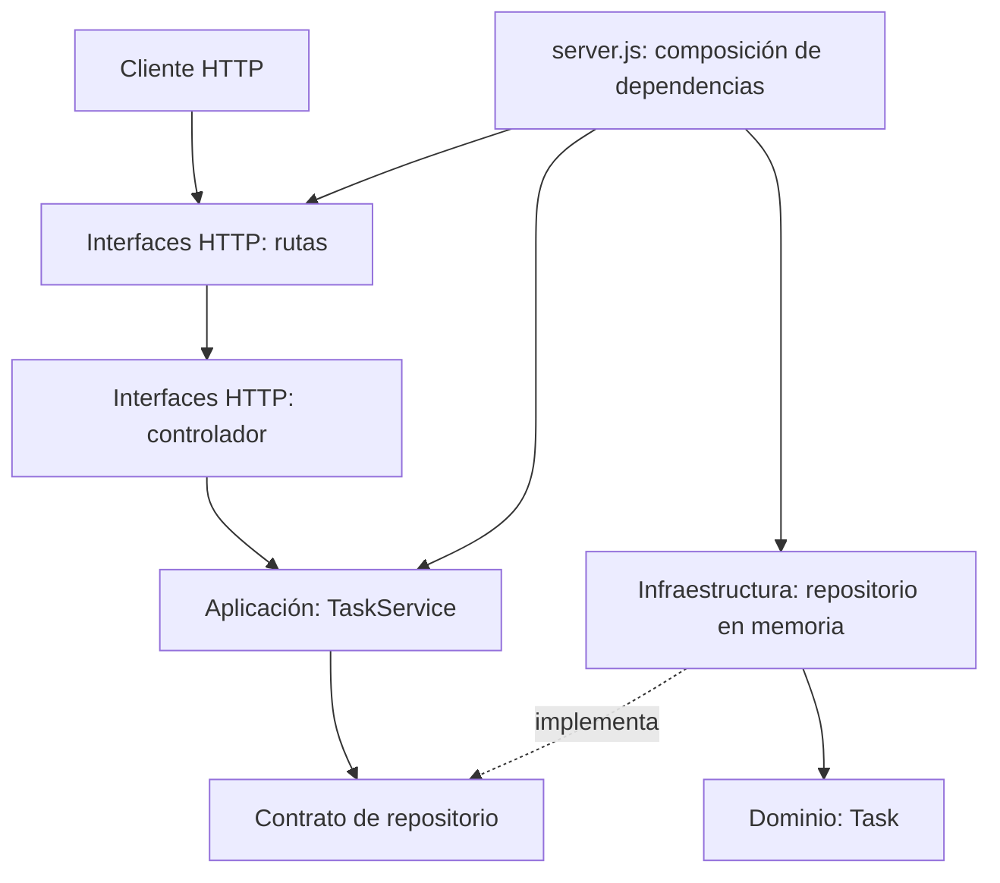

# Guía 5 — Gestor de tareas

Backend didáctico organizado con Clean Architecture para separar las reglas de negocio de Express y del mecanismo de persistencia.

## Estructura del backend

```text
backend/src/
├── domain/
│   └── Task.js
├── application/
│   └── TaskService.js
├── infrastructure/
│   └── InMemoryTaskRepository.js
├── interfaces/
│   └── http/
│       ├── TaskController.js
│       └── TaskRoutes.js
└── server.js
```



## Acoplamiento y calidad

- Las rutas y el controlador solo adaptan HTTP; no contienen reglas de negocio ni acceden a los datos directamente.
- `TaskService` depende del contrato que ofrece el repositorio (`findAll`, `create` y `updateStatus`), no de la implementación en memoria. Se puede sustituir por otra persistencia sin cambiar los casos de uso.
- `server.js` es el único punto de composición: instancia las implementaciones y conecta las capas.
- La separación permite probar las reglas de aplicación con un repositorio simulado, sin iniciar Express ni depender de una base de datos. Las pruebas cubren normalización y creación, validación del título, cambio de estado y errores de validación/no encontrado.

## Ejecución y pruebas

Desde `backend/`, instala las dependencias con `npm install` y ejecuta:

```sh
npm start
npm test
```

La API conserva los endpoints `GET /api/health`, `GET /api/tasks`, `POST /api/tasks` y `PATCH /api/tasks/:id/status`.
